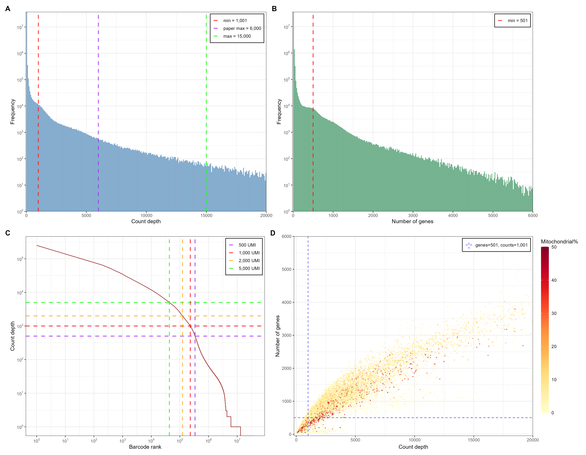
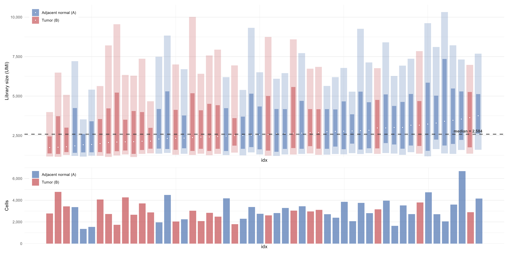
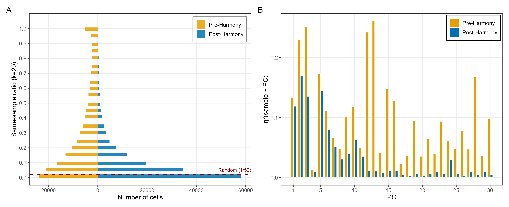
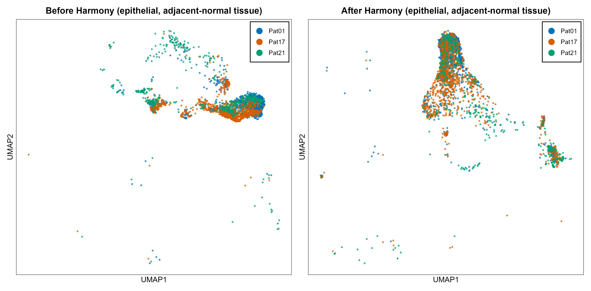
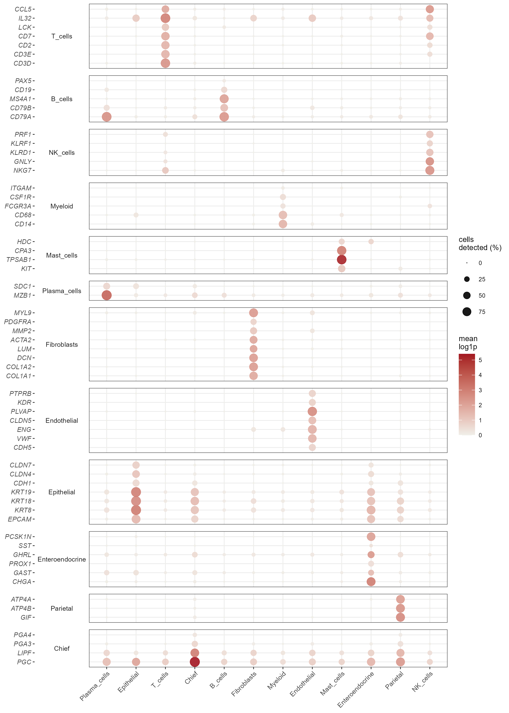
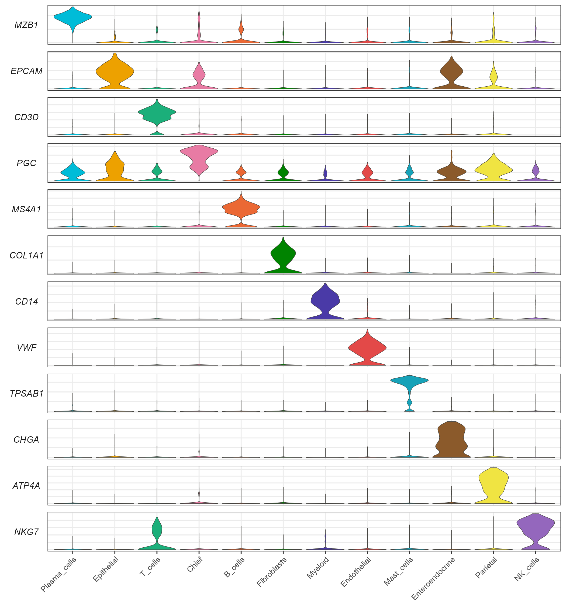
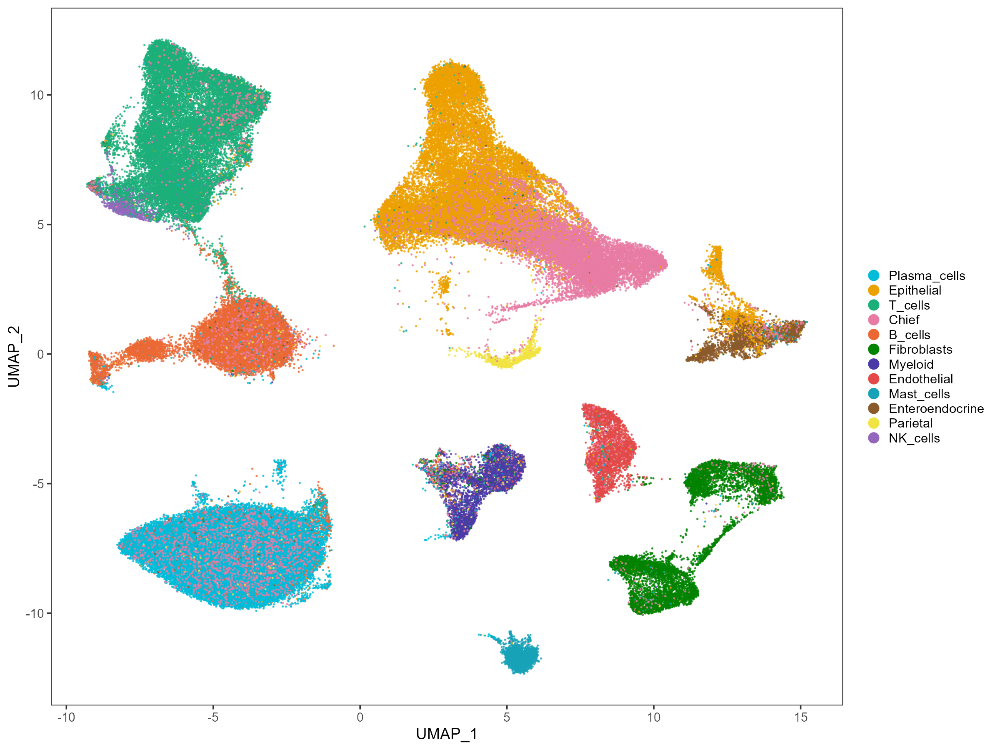
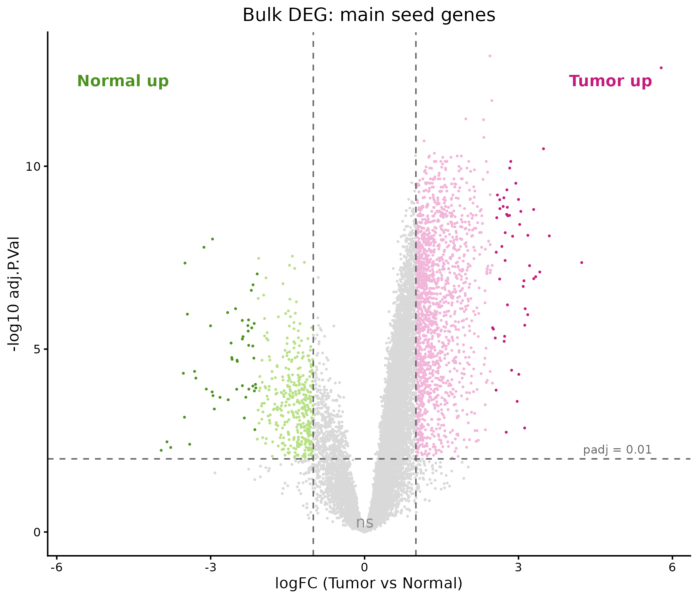

# Issue #26 — 迭代恶性细胞分类：数据处理概览

## 目录

1. [背景与结论速览](#1-背景与结论速览)
2. [框架 · 我们的分析系统设计](#2-分析系统设计框架)
3. [数据 · 为什么是 GSE150290 而不是 HRA000051](#3-数据--为什么是-gse150290-而不是-hra000051)
4. [结果 — 跑道 A：从原始数据到上皮细胞](#4-结果--跑道-a从原始数据到上皮细胞)
5. [结果 — 跑道 B：TCGA-STAD 种子基因集](#5-结果--跑道-btcga-stad-种子基因集)
6. [结果 — 汇合：迭代恶性细胞分类](#6-结果--汇合迭代恶性细胞分类)

---

> **参考论文**: [zhang2021_paper](/00_Doc/zhang2021_paper/464.full.pdf)  
> **论文 method**：[supp001.pdf](00_Doc/zhang2021_paper/supply_material/gutjnl-2019-320368supp001.pdf)

---

## 1. 背景与结论速览

- **复现对象**：论文迭代 K-means 恶性细胞分类方法 = TCGA-STAD bulk DEG 种子基因 → AddModuleScore → K-means k=2 → pseudobulk DEG → 迭代至收敛 → 输出"恶性 / 非恶性"标签。
- **数据**：论文原始数据 HRA000051 受控、不可获取（§3.1），改用公开数据 GSE150290（§3.2）——47 例癌症内镜活检 + 5 例非癌对照，共 52 个 10x 样本。
- 我们交付两件事：① 一条可复现的 R 管线（§2–§6）；② 对该方法的一份评价（§7）。
- **结论速览**：方法逻辑上自洽——所有配置与双种子下均稳定收敛（3–4 轮，一致性 91–96%）；但其输出的"恶性"标签没有生物学锚定，收敛轴推测是肠化生轴而非恶性轴，且迭代参照池被肿瘤细胞结构性污染。详见 §7。

---

## 2. 分析系统设计框架

基于原论文的方法学框架，设计了一个 **双跑道、单汇合** 的分析系统（各步细节见对应目录下的 README.md）：

```
══════════════════════════════════════════════════════════
跑道 A: scRNA-seq 预处理 → 上皮细胞鉴定
══════════════════════════════════════════════════════════

  01_Data/ ──→ 01_QC/ ──→ 02_Normalize_Batch/ ──→ 03_Cluster_Annotate/
  GSE150290     QC 过滤        log1p(CP10K) + CC/MT    Leiden 聚类 + 12 类注释
  52 样本       160,359 cells   回归 + Harmony          150,490 cells
  38.4M barcodes → Scrublet     → 02 输出 159,308        → 上皮谱系 44,011
                剔除 1,051

══════════════════════════════════════════════════════════
跑道 B: Bulk DEG → 种子基因集
══════════════════════════════════════════════════════════

  04_Bulk_DEG/
  TCGA-STAD Toil RSEM tpm（33 配对）
  → log2(TPM+1) + plain limma → 论文 Table S1 复现（top50 重叠 94/100）
  → Top 50 Tumor-up + Top 50 Normal-up

══════════════════════════════════════════════════════════
汇合: 迭代恶性细胞分类
══════════════════════════════════════════════════════════

  05_Iterative_Classify/
  上皮谱系细胞 (44,011) + 种子基因 (50+50)
  → AddModuleScore → K-means (k=2) → Pseudobulk 配对 Wilcoxon
  → 迭代至收敛 (≥90%) → 最终恶性/非恶性标签
══════════════════════════════════════════════════════════
```

---

## 3. 数据 · 为什么是 GSE150290 而不是 HRA000051

### 3.1 原论文数据不可获取

Zhang 2021 的原始 scRNA-seq 数据存放于 **GSA-Human**（国家基因组科学数据中心），accession **HRA000051**。尽管论文声明"data are available on reasonable request"，实际访问需要经过 **Data Access Committee (DAC) 审核**。


*图 3.1a: HRA000051 在 GSA-Human 数据库的访问页面。数据标注为"Controlled Access"，需要向 DAC (Omics_Data) 提交申请方可下载。*


*图 3.1b: 数据访问申请界面。NGDC 注册要求机构邮箱及身份验证，学生身份无法独立完成 DAC 审核流程。*

### 3.2 GSE150290

我们选择了 **Kim et al. (2022) *NPJ Precision Oncology*** 的公开数据集 **GSE150290**（韩国 National Cancer Center, PMID: 35087207）：
> 📎 数据来源：[GSE150290 — NCBI GEO](https://www.ncbi.nlm.nih.gov/geo/query/acc.cgi?acc=GSE150290)（Status: Public on Jan 30, 2022，无需注册即可访问元数据及下载 count matrix。）

**原始数据结构：**

GSE150290 包含 **52 个 10x Genomics 样本**（GEO 页面概述为 "47 biopsies"，指 47 例癌症患者内镜活检：23 GC 肿瘤 + 24 癌旁正常；另有 5 例非癌对照 Pat25–Pat29，GEO 标记为 "Control"；合计 52）。全部为内镜活检（GEO: "biopsies"），来自 24 例胃癌患者（Pat01–Pat24，其中 Pat21 仅剩 A 样本，配对 B 未通过 QC 故实际肿瘤样本为 23 例）。每个样本提供标准的 10x 输出：barcodes、features、matrix。

**Clinical information————**[Kim et al. 2022 Supplementary Table 1,第18页](/00_Doc/GSE150290/41698_2022_251_MOESM1_ESM.pdf)


*EGC 早期胃癌；AGC 进展期胃癌；CAG with IM 慢性萎缩性胃炎伴肠化生；CSG 慢性浅表性胃炎；*  
*Lauren： Intestinal 肠型 / Diffuse 弥漫型；*  
*LB 下体 / AW 前壁 / GC 大弯 / PW 后壁 / MB 中体 / UB 上体 / LC 小弯 / Angle 胃角 / Antrum 胃窦；*  
*MSS 微卫星稳定（MSI 列 − 即无微卫星不稳定）；+ 阳性 / − 阴性 / Equivocal 不确定 / 空白 未检测。对照患者（Pat25–29）无癌灶位置。*


选择 GSE150290 的优势是多重的：(1) 公开可获取，确保完全可复现；(2) 47 例癌症活检 vs 论文的 12 样本，统计功效显著增强；(3) 韩国独立队列为 Zhang 2021 方法提供了跨人群、跨机构的外部验证——这是原论文未曾进行的检验；

---

## 4. 结果 — 跑道 A：从原始数据到上皮细胞

### 4.1 Qc

**QC 阈值：** UMI ∈ [1,001, 15,000]；genes ≥ 501；MT ≤ 50%。

> **UMI 上界放宽**：从论文的 6,000 放宽至 15,000（P99.97，数据驱动）——6,000 天花板在此数据集上无自然悬崖、系统性截断大细胞。看家基因过滤省略：论文的 curated list 未随文公开，无法忠实复现。  
> **关于线粒体 50% 阈值**：胃上皮细胞代谢活动活跃，胃上皮组织中可能含有大量的线粒体。因此论文采用了更宽松的 50% 标准。



**Figure 1**  质控变量的分布图 (GSE150290).
**(A)** total UMI counts 直方图.
**(B)** gene numbers 直方图.
**(C)** UMI 计数的Rank图（双对数坐标系）。虚线标示了各计数阈值与相应 barcode 排序位置的交点。
**(D)** 基因数量与 UMI 总计数之间的关系，随机抽取 50,000 个的barcode；图中颜色代表线粒体基因占比（MT%）。


Data: After filtering (1,001 ≤ UMI ≤ 15,000, genes ≥ 501, MT% ≤ 50%), **160,359 high-quality cells** retained; 1,051 heterotypic doublets removed by Scrublet → **159,308 cells** 进入下游。

### 4.2 归一化(CP10K + log1p)


**Figure 2. library and cell的分布图.**  上图为libraries直方图，下图为cells直方图

### 4.3 批次校正：Harmony PCA

多样本 scRNA-seq 数据整合中，技术批次效应会混淆生物学信号。我们使用 **Harmony** (v2.0.5) 在 PCA 空间进行迭代校正，以 `sample_id` 为批次变量（52 个 10x run）。校正后 **mean η²(sample)（PC1-30）从 0.1014 降至 0.0345**；FNN k=20 同样本邻居比例从 0.283 降至 0.098（随机期望 1/52 ≈ 0.019）。

CC 评分 → HVG 3000（黑名单后精选）→回归 S/G2M/pct_mt（残差，不缩放）→ 残差方差重排 top 2000 → z-score（clip 10）→ PCA 50 → Harmony（key=sample；theta=2,
sigma=0.1, nclust=100）



**Figure 3.1 Batch effect correction validation.** **(A)** 每细胞相邻细胞 k=20 是属于同样本的比例（post后降低），虚线为随机线**(B)** PC 1-30 样本相关性，矫正后降低


**Figure 3.2 批次矫正 UMAP validation.** 抽取patient 01、17、21 adjacent cancer 侧的上皮类型细胞做示意图


### 4.4 聚类与细胞类型注释

使用 Harmony 校正后的前 50 PCs， Leiden 聚类（分辨率 r=0.5，20 clusters），剔除红细胞（583）与死细胞簇（8,235，簇中位 MT% > 25）后得到 **150,490 cells / 12 类型**。


我们采用 Kim 2022 + Zhang 2021 双来源 marker 的 12 类注释面板（Hybrid v2）——AddModuleScore（25 bins × 100 同 bin 对照扣除）打分后逐细胞 z-score，取 `argmax` 投票分配细胞类型（详见 [03_Cluster_Annotate/README.md](03_Cluster_Annotate/README.md)）。



**Figure 4.1 Marker_dotplot.** 各个细胞类型的marker效果


**Figure 4.2 Marker_violin.** 不同细胞类型的代表marker表达分布图


**Figure 4.3 umap_annotation.** 12 种细胞类型在 UMAP 上效果


**Figure 4.4 heatmap.** 12 种细胞类型对应簇的纯度

| 细胞类型 | 细胞数 | 比例 |
|:---|:---:|:---:|
| Plasma cells | 39,326 | 26.1% |
| Epithelial cells | 24,946 | 16.6% |
| T cells | 24,721 | 16.4% |
| Chief cells | 19,065 | 12.7% |
| B cells | 17,925 | 11.9% |
| Fibroblasts | 7,999 | 5.3% |
| Myeloid | 3,848 | 2.6% |
| Endothelial cells | 3,706 | 2.5% |
| Mast cells | 3,152 | 2.1% |
| Enteroendocrine | 2,933 | 1.9% |
| Parietal cells | 1,455 | 1.0% |
| NK cells | 1,414 | 0.9% |

其中 chief 是消化酶工厂，解离时容易破裂。并且 marker PGC 表达量高 1-2 个数量级，基因泄漏拷贝数最多，最先穿透空液滴对照减法。这是 scRNA-seq 局部 ambient 的剂量效应，不是注释方法缺陷。更多污染解析在[NOTES_suspected_contamination.md](/03_Cluster_Annotate/scripts/contamination_analysis/NOTES_suspected_contamination.md).

**44,011 个上皮谱系细胞**（Epithelial 24,946 + Chief 19,065）被提取，作为迭代分类的输入。低置信注释（z-delta < 0.5）共 15,940 细胞（10.6%），其中剔除后的运行见 §7.3。

---

## 5. 结果 — 跑道 B：TCGA-STAD 种子基因集

### 5.1 数据与方法

**主种子**：从 UCSC Xena Toil hub 下载 TCGA-STAD `tcga_RSEM_gene_tpm`（与论文同数据源，详见 [04_Bulk_DEG/README.md](04_Bulk_DEG/README.md)），STAD 子集 **33 对**配对肿瘤-正常样本；log2(TPM+1) 变换 + TPM>1 in ≥20% 低表达过滤（约 15,800 基因）+ plain limma 配对设计（TPM 非计数 → 无 voom）；adj.p < 0.01（无 FC 截断），每方向按 |logFC| 取前 50。与论文 Table S1 逐位核验：CST1 5.781 / PGA3 −3.965 逐位一致，top50 重叠 94/100。

另设一套**测试种子**（Xena HiSeqV2 + limma-voom，32 对配对）作结构敏感性对照（见 §7.3）。早期搭建期误将 HiSeqV2 矩阵当作论文数据源，对照 Table S1 与论文 method 后修正为主线 Toil；HiSeqV2 种子保留为测试种子而非丢弃。


**Figure 5 主种子数据集 DEG 火山图.** 无 FC 截断；|logFC|>1 仅作为火山图着色边界，不参与筛选，深色点即为选择的种子基因。

**种子基因代表性成员**：

| 方向 | 代表基因 | 功能 |
|:---|:---|:---|
| Tumor-up (50) | CST1, CLDN3, KRT7, APOC1, TNFRSF6B, MSLN, CLDN4, UBE2C, UBD, GDF15, MISP, MMP7... | 增殖、紧密连接、肠型上皮 |
| Normal-up (50) | PGA3, PGA4, GKN1, DES, PGA5, MAL, C2orf40, GKN2, MYH11, ACTG2, DPT, ATP4B... | 胃酸分泌、消化酶、胃黏液保护、平滑肌（癌旁正常含肌层） |

⚠️ 注意：种子基因来自 bulk 组织 DEG，包含非上皮来源的信号（如癌旁正常中的平滑肌基因 DES/MYH11/ACTG2，以及免疫细胞差异）。这正是原论文需要迭代步骤的原因——bulk 种子中混杂的非上皮信号将在 sc-level 迭代中被逐步过滤。

---

## 6. 结果 — 汇合：迭代恶性细胞分类

### 6.1 算法实现

我们在 R 中完整实现了迭代分类框架（[`step2_iterative_classify.R`](05_Iterative_Classify/scripts/step2_iterative_classify.R)），核心循环为：

```
种子基因 (50 Tumor-up + 50 Normal-up，Table S1 复现)
       │
       ▼
  AddModuleScore (25 bins, 100 ctrl per gene, 44,011 上皮谱系细胞)
       │
       ▼
  2D scores × 44,011 cells
       │
       ▼
  K-means (k=2, nstart=25, seed 42) ─→ "推定恶性" / "推定非恶性"
       │
       ▼
  Pseudobulk 聚合 (patient × label) → 配对 Wilcoxon
       │
       ▼
  每方向按显著性取前 50 → 重新打分
       │
       ▼
  检查收敛 (标签一致性 ≥ 90%)
       │         │
       │    ┌────┘
       │    ▼
       │  未收敛: 继续迭代 (上限 10 轮)
       │
       ▼
     收敛: 输出最终标签 + 基因签名
```

### 6.2 收敛轨迹

迭代在 **4 轮后收敛于 91.0% 一致性**（阈值 ≥ 90%）：

| 轮次 | 恶性细胞 | 非恶性 | 一致性 | 收敛 |
|:---:|:---:|:---:|:---:|:---:|
| 1 (种子切分) | 16,347 (37.1%) | 27,664 | — | ❌ |
| 2 | 13,115 (29.8%) | 30,896 | 85.2% | ❌ |
| 3 | 20,281 (46.1%) | 23,730 | 82.9% | ❌ |
| 4 | **22,207 (50.5%)** | **21,804** | **91.0%** | ✅ |


### 6.3 最终 DEG 结果

最终 pseudobulk 配对 Wilcoxon 鉴定出 **50 个恶性基因**和 **50 个非恶性基因**（每方向按显著性取前 50）：

| 方向 | Top 基因（前 10） |
|:---|:---|
| 恶性 (50) | TFF1, S100A6, PHGR1, ACTB, TMSB4X, GKN1, KRT19, KRT8, APOA1, TMSB10 |
| 非恶性 (50) | PGC, LIPF, LYZ, IGJ, REG3A, IGLL5, REG1A, LTF, RP11-1143G9.4, MUC6 |

恶性方向以胃表面/粘蛋白与肠化生程序为主（TFF1、GKN1、APOA1）；非恶性方向以胃消化酶为主（PGC、LIPF、LYZ），但**混有浆细胞/免疫相关基因（IGJ、IGLL5，深处还有 CD74、HLA-DRA、MZB1）**——最终签名并非纯上皮身份对比。

### 6.4 敏感性分析

为了评估输入的种子基因集和初始数据结构对迭代聚类最终分类效果的影响，我们使用了两套种子基因集（一套论文method指定的 Toil tcga_RSEM_gene_tpm 复现，一套测试种子 TCGA HiSeqV2 产出）。


对主种子集（与论文 Table S1 逐位一致，94/100，末尾排名扰动），做6 run不同对照条件下分析；对测试种子集做 run 1、6 条件下分析（数据构成条件与论文一致），详细分析请看[05_Iterative_Classify/README.md](/05_Iterative_Classify/README.md)，或者详细结果数据集[per_patient_malignant.csv](/05_Iterative_Classify/data/per_patient_malignant.csv)。


**Ctrl 恶性率非 0**（3.3–41.6%）：推测是因为对照组为慢性胃炎（Pat25-29），含少量 IM 细胞（慢性胃炎→肠化生是 Correa 级联的常见伴随病变），导致方法按身份轴将ctrl划为"恶性"——————（恶性=肠化生混淆）

---